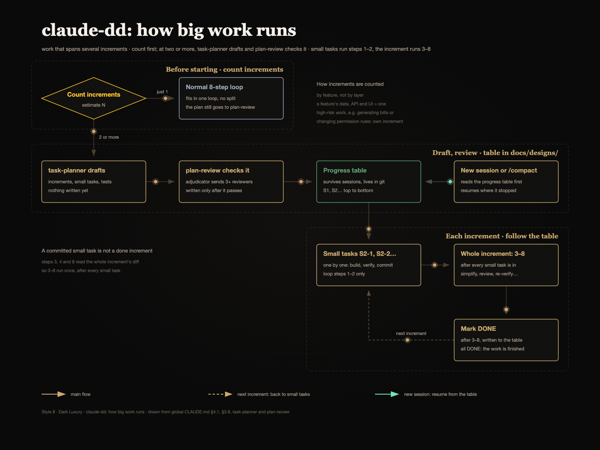
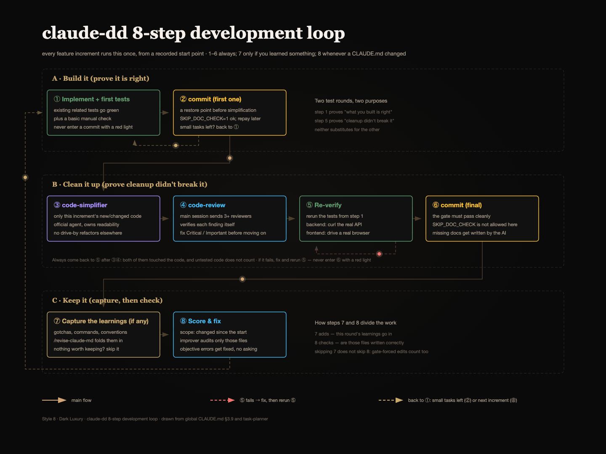
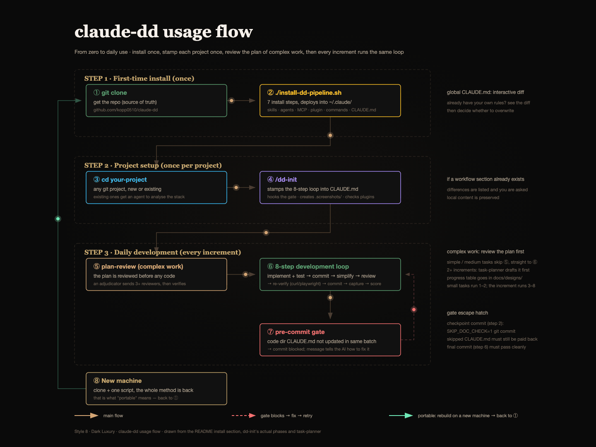

[English](README.md) | [繁體中文](README.zh-TW.md)

# DD Pipeline (claude-dd)

> A portable Claude Code profile — turning "did the AI actually follow the rules?" into output you can see and gates that can block you

**What it is**: a Claude Code profile you can carry between machines — skills, agents, commands, scripts, output styles, and a global `CLAUDE.md`. Clone the repo, run one bash script, and your whole working style is installed into `~/.claude/`. This repo is the source of truth; `~/.claude/` is always a deployment of it.

**What it actually does**: three things, with honestly different strengths.

1. **A pre-commit hook that blocks commits** when a directory containing code has no `CLAUDE.md`, or has one that wasn't staged in the same commit. This one is real enforcement — it's a shell script with `exit 1`, it doesn't care what the AI decided.
2. **A global `CLAUDE.md`** that tells Claude to cite a source for API signatures, version numbers, and project facts, and bans hedges like "should be" / "probably".
3. **An 8-step loop** stamped into each project's `CLAUDE.md` so every feature increment goes through simplify → review → re-verify before the final commit.

**Only #1 is enforcement.** Claude Code loads `CLAUDE.md` as context, not configuration ([docs](https://code.claude.com/docs/en/memory): "Claude treats them as context, not enforced configuration"), so #2 and #3 only raise the floor and leave an auditable record. Anything that must happen every time belongs in a hook.

**Who it's for**: people (or small teams) who use Claude Code daily, keep re-typing the same corrections, want them to survive a machine change, and would rather have a commit blocked than docs that no longer match the code.

**Who it's not for**: anyone after a lightweight setup (the gate will block you, sometimes for a one-off change), or a team that doesn't yet agree stale docs are a real problem. The rule text, skill definitions and installer output are in Traditional Chinese; the mechanisms are language-independent, and translating the global template is the one change needed to adopt it in another language.

## Highlights

- **Fewer stops to ask** — reversible steps just happen (including local commits and running existing tests); it only stops for destructive actions, scope changes, or information only you can give. Pushing is always left to you
- **Criteria for writing docs and comments** — §3.10 of the global CLAUDE.md, which applies even to projects that don't run the loop: enumerate instead of writing counts, print the cited line when checking a line-number reference, and when fixing "the same claim stated in N places", search by the criterion rather than by the first sentence you found
- **Explicit skill triggering** — when a skill should have fired and didn't, a concrete reason is written out, so skipping leaves an auditable line
- **Usage-inventory model** — only components with an evidenced usage record are kept, all shipped by default
- **Global CLAUDE.md template** — the single source for all of the above, deployed to `~/.claude/CLAUDE.md` after an interactive diff

## Installation

### Prerequisites

- [Claude Code CLI](https://claude.com/claude-code), Node.js, Git, Bash — all four are hard requirements; the installer exits if one is missing
- Required MCP: `playwright` — the installer checks for it but will not install it, so set up [playwright MCP](https://github.com/microsoft/playwright-mcp) first
- **`jq` or `python3`** (either one) — soft dependency. Without both, the plugin step is skipped entirely and the MCP check degrades to string matching, yet the install still succeeds
- Optional: `ffmpeg` — GIF export in tech-diagram-gif; without it that skill delivers SVG. On macOS: `brew install ffmpeg`
- The claude-md-management and skill-creator plugins must already be present locally (via the official marketplace). The installer only registers a plugin it can already find on disk — it never downloads one. Install `skill-creator` yourself once first: `claude plugin install skill-creator@claude-plugins-official`

### First-time install

```bash
git clone https://github.com/kopp0510/claude-dd.git
cd claude-dd
./install-dd-pipeline.sh
```

> If `install-dd-pipeline.sh` isn't executable, run `chmod +x install-dd-pipeline.sh` first.

The installer reports its progress as 7 steps (`1/7` … `7/7`):

1. Check the environment (the hard requirements above; missing any one aborts the install)
2. Install 12 promoted Skills into `~/.claude/skills/`
3. Install 4 promoted Agents into `~/.claude/agents/` (local backups of code-simplifier / code-reviewer, plus senior-devops / security-auditor)
4. Check MCP servers (read-only — reports scope, installs nothing)
5. Register the official plugins (claude-md-management — the dependency behind nested CLAUDE.md maintenance; skill-creator — authoring and eval-testing skills). A plugin that isn't on disk or has no readable version is skipped, with the `claude plugin install` command to run
6. Install the `/dd-init` command and the `workflow-review` namespace into `~/.claude/commands/`
7. **Diff the global CLAUDE.md** (`~/.claude/CLAUDE.md`): if it differs from the repo template, the diff is shown and you're asked whether to overwrite — keeping your local copy is the default. **On a machine with no global CLAUDE.md yet, this step asks whether to install it and defaults to No** (non-interactive runs take the default too) — answer `y`, or use `--force`, to actually get the full profile. `--force` also skips the diff prompt and overwrites; see [Upgrading](#upgrading)

Plus unnumbered steps: before step 2, every skill's `hooks.json` command paths are checked (a relative path aborts); between steps 6 and 7, `check-claude-md.sh` (the gate itself) goes into `~/.claude/scripts/` and `adhd.md` (the ADHD response style) into `~/.claude/output-styles/`.

### Install options

```bash
./install-dd-pipeline.sh --help              # show help
./install-dd-pipeline.sh --check             # check the environment only, install nothing
./install-dd-pipeline.sh --force             # reinstall, overwriting existing files
./install-dd-pipeline.sh --commands-only     # install commands only
./install-dd-pipeline.sh --update            # update skills and agents
./install-dd-pipeline.sh --uninstall         # remove what this repo deployed
./install-dd-pipeline.sh --uninstall --yes   # uninstall without confirmation (for automation; in non-interactive environments every prompt takes its default)
```

## Upgrading

Routine update:

```bash
git pull && ./install-dd-pipeline.sh --force
```

> **`--force` overwrites your global `CLAUDE.md` without asking.** The interactive diff described above only runs *without* `--force`. The previous version is backed up to `~/.claude/backups/pre-install-<timestamp>/` and the path is printed in the completion message, so it is recoverable — but if you have local edits you want to keep, run the installer without `--force` first and choose `k` (keep local).

For upgrades from older layouts and for moving an existing project onto the 8-step cycle, see [UPGRADING.md](UPGRADING.md) *(Traditional Chinese)*.
Structural changes over time are in [CHANGELOG.md](CHANGELOG.md) *(Traditional Chinese)*.

## The core loop: 8-step development cycle

Every **feature increment** runs this (defined in global CLAUDE.md §3.9; the project-specific version is stamped in by `/dd-init`):

```
1. Implement + get the first round of tests passing (never enter a commit with a red light)
2. commit (first one — preserves a restore point from before simplification)
3. code-simplifier (on that increment's diff)
4. code-review (on that increment's diff, run in full — one exception below; Critical/Important findings must be fixed before continuing)
5. Re-verify — rerun the tests, plus curl against the real API / drive a real browser with playwright (screenshots go to .screenshots/)
6. commit (final version)
7. Capture what this round taught you (only if there is something) — `/revise-claude-md` folds any gotcha, command or convention into `CLAUDE.md`
8. Score & fix the CLAUDE.md files this round touched — compute the scope first, then `claude-md-improver` audits only those files
```

Step 7 adds, step 8 checks — and the order matters: run 8 first and step 7 would immediately drop new content into the files it just cleaned up. Skipping 7 does not skip 8: the CLAUDE.md edits the gate forces need auditing too — the gate only confirms something was written, not that it was written correctly. Steps 3, 4 and 8 all measure the increment from its recorded start (set with `~/.claude/scripts/check-claude-md.sh --start-segment` before step 1, read back with `--segment-base`; with a `task-planner` progress table, the start in the table wins), because the last commit alone misses most of it.

Three quality mechanisms, one axis each: the simplifier owns readability, code-review owns correctness and compliance (plus a 12-item Fowler code-smell baseline, carried only when the change adds or restructures code), and real-environment verification owns behaviour. Step 4 has one exception: when the increment's diff is all data, configuration, comments or documentation, or the change is already fully covered by the project's mechanical checks, no agent is dispatched — you check it yourself and attach the evidence. Otherwise the main session **dispatches at least three reviewers itself, in parallel from a single message** (one run only finds part of it; the five-run experiment is in [CHANGELOG.md](CHANGELOG.md) *(Traditional Chinese)* — search for 「兩發聯集平均」), then verifies each finding against the code; there is no separate adjudicator in between (comparison in `docs/measurements/2026-10-23-reviewer-real-sessions.md`). What goes into the dispatch and how reports are filed: `templates/global/CLAUDE.md` §3.9, step 4.

**Work that spans several increments** goes to `task-planner` first: it splits the work into ordered increments with small tasks inside each, and writes the progress table into a design doc under `docs/designs/`. A small task runs only steps 1 and 2; once every small task in an increment is committed, the increment runs steps 3–8. The draft goes through `plan-review` before anything is written, and a new session or `/compact` picks up from the table. You don't have to ask: before complex work Claude estimates how many increments it needs and calls `task-planner` itself at two or more (rules in `templates/global/CLAUDE.md` §4.1 and `skills/task-planner/SKILL.md`).





Step 1 proves the thing you built is right; step 5 proves that simplifying it and applying review findings didn't break it. Different purposes — neither substitutes for the other.

The full path from zero to daily use (install once, stamp each project once, put the plan for complex work through `plan-review`, then every feature increment runs the same loop):



### CLAUDE.md maintenance rules (enforced by pre-commit gate)

- Every folder containing code needs a `CLAUDE.md`, updated in the same batch as the code. The cascade upward through the parent layers is a §3.9 rule, **not** something the gate checks — it only looks at the directory whose code changed, so a stale parent produces no signal at all
- The gate is `~/.claude/scripts/check-claude-md.sh`, hooked by `/dd-init` into `.git/hooks/pre-commit`, or into the `core.hooksPath` directory when one is set (this repo is). For projects that manage hooks with the pre-commit framework or lefthook, `/dd-init` does not add the gate automatically — it hands you a snippet to add to `.pre-commit-config.yaml` / `lefthook.yml` yourself (husky v9: `.husky/pre-commit`). When the gate script is missing (a collaborator without claude-dd), it only warns and the commit goes through; when it blocks, the message tells the AI how to fix it
- **The memory filename is configurable**: it defaults to `CLAUDE.md`, and `git config --local dd.docfile GEMINI.md` makes the gate look for that name instead, for repos allowed only one specific filename. Only `--local` is read: a global setting, `-c dd.docfile=…` and `GIT_CONFIG_PARAMETERS` do not take effect — one decision per repo
- It only fires on code extensions (`js|ts|py|go|rs|sh|…`) and skips `node_modules`, `dist`, `.screenshots`, `migrations` and friends. A markdown- or config-only change does not trigger it *by itself* — but see the next point: SKIP debt blocks it anyway
- Escape hatch for checkpoint commits (step 2): `SKIP_DOC_CHECK=1 git commit`. The final commit (step 6) must pass cleanly. Skipping is not a pardon: the gate tracks every directory skipped since the increment's start, and the next normal commit — even one with no code in it — is blocked until those directories' `CLAUDE.md` files are updated
- `git commit --no-verify` / `-n` skips the gate entirely. When Claude tries it, `gate-guard` denies the command and points to `SKIP_DOC_CHECK=1`. It only guards Claude — a human typing `--no-verify` in a terminal is not stopped; it is installed globally, so it applies even in projects without the gate

## Why nested CLAUDE.md files

The gate demands one `CLAUDE.md` per code-bearing directory rather than one big file at the root. That's a deliberate trade, and it isn't free.

**The mechanism** (from the [official docs](https://code.claude.com/docs/en/memory)): `CLAUDE.md` files *above* your working directory are "loaded in full at launch", while files in *subdirectories* "load on demand when Claude reads files in those directories". Everything discovered is concatenated, not overridden, ordered from the filesystem root down — so the file closest to where you're working is read last.

**Why it's worth it**

- **Context is the scarce resource.** The docs recommend keeping a single `CLAUDE.md` under 200 lines, because "longer files consume more context and reduce adherence". A monorepo can't describe every subsystem in 200 lines. Nesting lets `src/api/CLAUDE.md` cost nothing until Claude actually opens something in `src/api/`.
- **`@import` does not solve this.** It's the obvious alternative and it doesn't work for context: imported files "still load and enter the context window at launch". Splitting a big file into imports buys you organization, not budget. Real subdirectory files are the only mechanism that defers loading.
- **The docs go where the change goes.** A rule about the API layer sitting next to the API layer is more likely to be updated when that layer changes — which is precisely what the gate enforces by requiring the same-batch update.

**What it costs, what's already mitigated, and what's left**

- **Documentation theatre.** The gate verifies a file exists and was staged. It cannot verify the content is true.
  *Mitigation*: the gate's message dictates the repair format (read the directory, then write its job, key files, conventions and relationship to the parent), and §3.9 of the global template requires writing what you actually read.
  *Residual*: that is context, not enforcement — a determined shortcut still passes; the gate only raises the cost of faking it.
- **Friction on small changes.** Adding a `CLAUDE.md` for a directory you only meant to touch once is real overhead.
  *Mitigation*: it only fires on code extensions; `SKIP_DOC_CHECK=1` covers checkpoint commits, but only defers — the next normal commit still asks for the file.
  *Residual*: the first commit that puts code into a new directory costs you a file.
- **More files, more contradictions.** "If two rules contradict each other, Claude may pick one arbitrarily."
  *Mitigation*: step 8 of the loop runs `claude-md-improver` on the files the round touched, and §3.9 asks for a check up the parent layers.
  *Residual*: nothing *detects* a contradiction; periodic review is still on you.
- **Nested files don't survive `/compact`.** Per the docs, root `CLAUDE.md` is re-injected after compaction but nested files "are not re-injected automatically; they reload the next time Claude reads a file in that subdirectory".
  *Mitigation*: editing code in that directory means reading a file there first, which reloads it.
  *Residual*: only changing code from memory after a compaction without reading anything there.

If those trade-offs still sound worse than the problem you have, use a single root `CLAUDE.md` and don't install the gate. The 8-step loop works without it.

## Commands

| Command | Description |
|---------|-------------|
| `/dd-init` | Initialise a project: stamp the 8-step cycle into `CLAUDE.md`, hook up the pre-commit gate, create `.screenshots/` (only when the project has a frontend — pure backend/CLI skips it), verify plugin dependencies |
| `/workflow-review:review` | Combined code review — security, performance, configuration. It's a namespaced command, so the colon form is the callable name |
| `/output-style ADHD` | Turn on the ADHD response style (action first, numbered steps, progress every turn, short lists, no preamble or closers; written in Traditional Chinese); `/output-style default` turns it off. Claude Code reads style files at startup, so restart after installing. It applies to the current project only (saved to `.claude/settings.local.json`); for a default everywhere, set `"outputStyle": "ADHD"` in `~/.claude/settings.json` — a project's own `.claude/settings*.json` `outputStyle` still wins |

## Promoted Skills (12, deployed by default)

> "Promoted" means the component has an evidenced usage record and therefore ships by default. One exception: `gate-guard` is a safeguard for the gate, not a skill that earned its place through use.

| Skill | Description |
|-------|-------------|
| code-simplifier | Code simplification (the wrapper used at step 3 of the loop) |
| design-brainstorm | Socratic design dialogue — look facts up yourself, only ask the human about decisions |
| frontend-design | Frontend visual design |
| gate-guard | Hook-only plugin (no skill): stops Claude from bypassing the `CLAUDE.md` gate with `git commit --no-verify` / `-n` / `-c core.hooksPath=` (turning hooks off beforehand with `git config core.hooksPath` is not caught) |
| plan-review | Adversarial plan review — an adjudicator (Opus) sends 3+ reviewers (haiku) to attack the plan, then keeps only the criticism that checks out |
| review | Combined-review wrapper |
| self-improving-agent | Memory auditing and knowledge distillation |
| task-planner | Feature-increment planning, with the progress table written into the design doc |
| tech-diagram-gif | Technical diagrams with GIF export (style specs vendored from [fireworks-tech-graph](https://github.com/yizhiyanhua-ai/fireworks-tech-graph)) |
| verification-gate | Pre-completion gate — claiming done requires fresh evidence |
| worktree-manager | Git worktree isolation |
| writing-great-skills | Reference for writing skills (vendored from [mattpocock/skills](https://github.com/mattpocock/skills), user-invoked) |

## Official plugins (managed by the installer)

| Plugin | Purpose |
|--------|---------|
| claude-md-management | Auditing and updating nested CLAUDE.md files (`claude-md-improver` skill + `/revise-claude-md`) — the documentation-maintenance dependency of the 8-step cycle |
| skill-creator | Authoring skills and measuring them: interview → draft → run the same eval prompts with and without the skill → grade → iterate. Complements `writing-great-skills`, which is the reference for *how to write* one. Its `scripts/quick_validate.py` needs PyYAML (`pip3 install pyyaml`); the rest of the skill works without it |

### Recommended third-party plugin (not managed by the installer)

| Plugin | Purpose | Install |
|--------|---------|---------|
| [claude-mem](https://github.com/thedotmack/claude-mem) | Cross-conversation memory (records sessions via lifecycle hooks, with bundled search tools) | `npx claude-mem install` |

> claude-mem is a plugin, not an MCP server, so the installer's MCP check does not see it.

## MCP

The installer checks for MCP servers but never installs them, and it **distinguishes configuration scope**. A ✅ requires the server to be under the root `mcpServers` key of `~/.claude.json` (official scope name `user`, available in every project). A server configured only under an individual project (official scope `local`) is reported as "configured in N projects only" — it is unavailable elsewhere, which for a working method built around portability is equivalent to not installed.

Degraded states are reported distinctly, so "I can't tell" never turns into a confident claim:

| Situation | Reported as |
|---|---|
| `~/.claude.json` can't be parsed (corrupt) | 無法判定 — cannot determine |
| Neither `jq` nor `python3`, name found by string match | 疑似已設定…範圍未知 — probably configured, scope unknown |
| Neither `jq` nor `python3`, name not found | 未安裝 — not installed (a required MCP also gets a ❌) |

That last row is the honest caveat: a string-match miss is reported as not installed, though it can't actually prove that.

> **Limitation**: the third official scope (`project` — a `.mcp.json` in the project root) does not live in `~/.claude.json`, so this check cannot see it and will under-report in that case. For the complete picture use `claude mcp list`, which lists all three scopes.

When installing an MCP server, specify user scope so it is available in every project:

```bash
claude mcp add --scope user context7 -- npx -y @upstash/context7-mcp@latest
```

### Required

| MCP | Description | Source |
|-----|-------------|--------|
| playwright | Browser automation (frontend verification at step 5 of the loop) | [playwright-mcp](https://github.com/microsoft/playwright-mcp) |

### Optional

| MCP | Description | Source |
|-----|-------------|--------|
| context7 | Version-accurate official library documentation (backs global CLAUDE.md §2.5, "never infer an API from its name") | [@upstash/context7-mcp](https://github.com/upstash/context7) |
| sequential-thinking | Sequential reasoning | [@modelcontextprotocol/server-sequential-thinking](https://www.npmjs.com/package/@modelcontextprotocol/server-sequential-thinking) |
| serena | Code assistant | [serena](https://github.com/oraios/serena) |
| zeabur | Cloud deployment platform | [zeabur-mcp](https://zeabur.com/docs/en-US/mcp) |
| google-docs | Google Docs integration | [google-docs-mcp](https://github.com/a-bonus/google-docs-mcp) |
| googleDrive | Google Drive integration | [gdrive-mcp-server](https://github.com/felores/gdrive-mcp-server) |

## Cleaning up foreign leftovers (manual)

The installer only manages what **this repo deployed**. Leftovers written into `~/.claude/skills/` by other sources — third-party skill installers, older install bundles — have to be cleaned up by hand. The known shapes and the commands to find them are documented in [CLAUDE.md, "殘留清理（手動）"](CLAUDE.md#殘留清理手動) *(Traditional Chinese)*, kept there as the single maintenance source so two documents can't go stale independently.

## License

MIT License

Vendored content, each shipping its own upstream licence file:

| Path | Licence | Upstream |
|------|---------|----------|
| `skills/writing-great-skills/LICENSE.txt` | MIT | [mattpocock/skills](https://github.com/mattpocock/skills) — the Fowler smell baseline section of `agents/code-reviewer.md` is adapted from the same source |
| `skills/frontend-design/LICENSE.txt` | Apache-2.0 | attribution/NOTICE terms apply |
| `skills/tech-diagram-gif/LICENSE.txt` | MIT | fireworks-tech-graph contributors (style rules only; see the file for exactly which parts) |
| `skills/self-improving-agent/LICENSE` | MIT | Reza Rezvani |
| `output-styles/LICENSE.txt` | MIT | [ayghri/i-have-adhd](https://github.com/ayghri/i-have-adhd) (rules only; see the file for where each section went) |
| `commands/workflow-review/` | **Not stated** | Alireza Rezvani — vendored in `7248a15`. No LICENSE file came with it and the upstream repo was never recorded, so no licence can be assumed. Attribution is kept in `review.md`'s header |

Intake rules: [CLAUDE.md, "第三方 Skill / Agent 收編檢查清單"](CLAUDE.md) *(Traditional Chinese)*.

## Contributing

Issues and pull requests are welcome.
